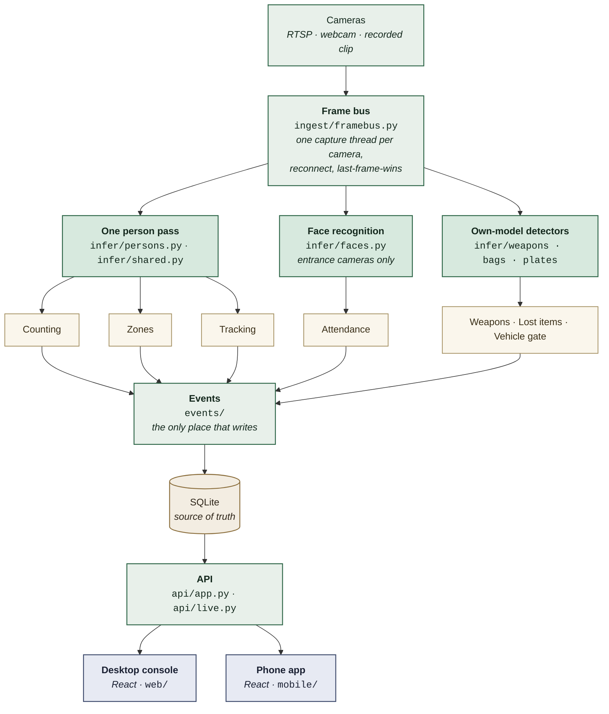
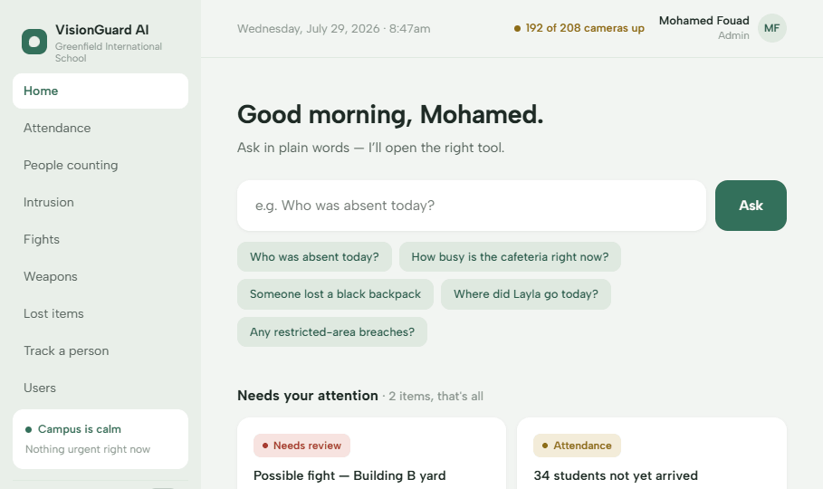
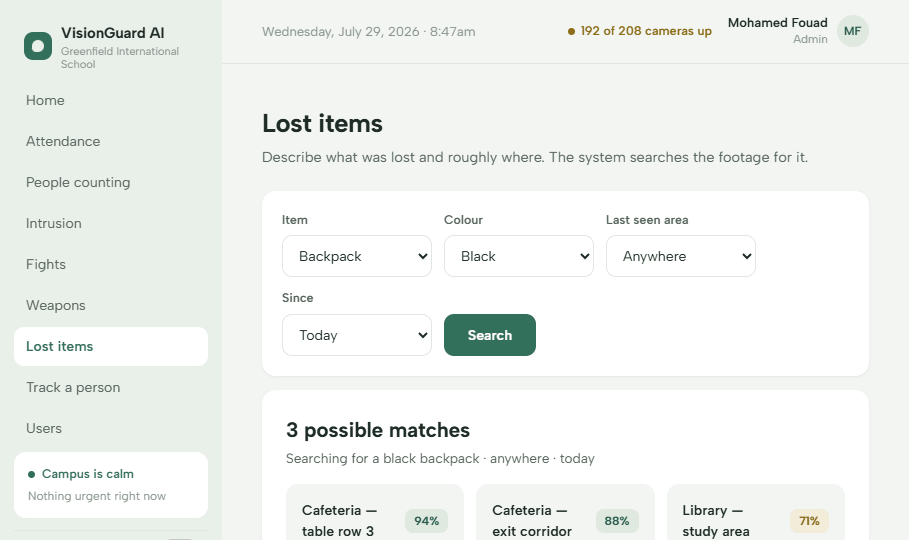
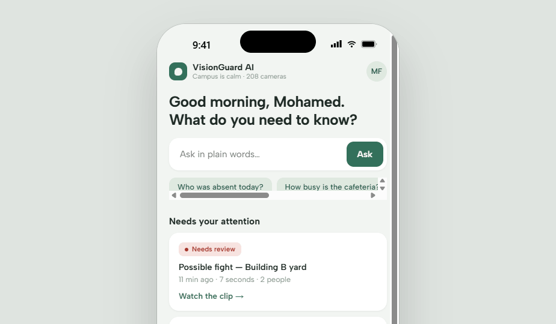

# VisionGuard

A campus vision system for schools and organisations — a console that answers
questions about activity on site (attendance, headcounts, restricted zones,
weapons, lost items, where a person went) **with the footage attached**.

It is not built for one customer. Each deployment names its own site, cameras
and zones in `engine/engine.yaml`; the product ships with that name blank.

> **Read `STATUS.md` before showing this to anyone.** Camera ingest,
> attendance, browser enrolment, live overlays, the tracking engine, the
> vehicle gate and counting for one area run on **real data**. Restricted
> zones, weapons, lost items, users, audit and notifications are still
> **fixtures**, and there is **no authentication on the mobile app yet**.

---

## How it works

One person-detection pass per frame, fanned out to every feature that needs
people. Face recognition runs separately, on entrance cameras only, because it
is the expensive one.



Workers turn frames into events; events go to SQLite; the API serves both apps.
Every worker inherits its threading, rate limiting and boost from
`engine/vg/features/base.py` — **a feature writes no concurrency code of its own.**

### The one rule that shapes everything

Two identity signals are kept deliberately separate:

**A face names a person. Clothing only says "the same body."**

They are never merged into one number or one colour. Green means identified by
face, blue means matched by appearance, amber means unidentified. Tracking
never uses recognition to track — a name is a live annotation on a body, never
a stored binding carried forward. A leaked binding is what once made every
person on the screen read as "Mohamed Fouad".

---

## Run it

```powershell
.\dev.ps1 doctor                     # pre-flight checks — run first
.\dev.ps1 up -Mock                   # UI work: instant start, no models, no camera
.\dev.ps1 up -Clip                   # pipeline work: deterministic recorded clip
.\dev.ps1 up -AllowSystemPython      # real cameras
.\dev.ps1 down                       # stop everything, free the ports
```

Console at `http://localhost:5173`, engine at `http://127.0.0.1:8000`,
API reference at `/docs`.

One extra install the first time — the appearance matcher is a package in this
repository, not something on the path:

```powershell
pip install -e vendor/loiterwatch
```

There is no `.venv` yet — deliberately, until the re-ID model handover decides
the Python version. System Python 3.14 works (torch 2.11.0+cu128, CUDA on an
RTX 2080).

## Test it

```powershell
python -m pytest engine
cd web; npx tsc -b --force     # NOT --noEmit: project references make it a silent no-op
python -m pyflakes engine/vg engine/tools engine/tests
```

`CONTRIBUTING.md` explains why each of those gates exists.

---

## Where everything is

```
engine/     Python · FastAPI + OpenCV/YOLO — the vision engine and the API
web/        React desktop console — wired to the engine
mobile/     React phone app — still on fixtures

models/     Model weights (untracked) + what each one actually is
vendor/     Code we did not write: loiterwatch, gate-anpr, bag-tracker
datasets/   Owner-supplied evaluation data (untracked)

design/     The visual designs the apps were built from
docs/       Plan, handoff, manual test, and archived history
specs/      One folder per feature: spec, plan, tasks, contracts, evidence
.specify/   Spec-kit machinery — templates, scripts, and the constitution
```

Each of `engine/`, `models/`, `vendor/`, `datasets/`, `design/`, `docs/`, `web/`
and `mobile/` has its own README saying what belongs there.

### The files worth knowing by name

| Path | What |
|---|---|
| `engine/engine.yaml` | The deployment: site name, cameras, zones, which model runs where |
| `engine/vg/config.py` | Reads `engine.yaml` + `.env`, and validates everything |
| `engine/vg/ingest/` | Camera capture, reconnect, frame bus, recording |
| `engine/vg/infer/` | Model runners — one file per model |
| `engine/vg/features/` | One file per product feature. Subclass `FeatureWorker` |
| `engine/vg/events/` | Database writes |
| `engine/vg/identity/` | Face gallery, enrolment, appearance matching |
| `engine/vg/api/app.py` | Every endpoint |
| `engine/vg/api/store.py` | `MockStore` — the fixtures |
| `engine/vg/api/live.py` | `LiveStore` — **what it doesn't override is the to-do list** |
| `web/src/services/api.ts` | The only place the console talks to the engine |
| `models/README.md` | What each weight file actually is. **Read before touching weapons** |
| `engine/data/footage/` | Recorded clips + 21 labelled ground-truth marks — the regression suite |

**Adding a feature touches four files and nothing else.** The API contract and
both front ends stay untouched — see `CONTRIBUTING.md`.

---

## The documents

| File | What it is |
|---|---|
| `.specify/memory/constitution.md` | The engineering rules. **Highest authority** |
| `docs/PLAN.md` | What to build and in what order. **The only plan** |
| `STATUS.md` | What is real today, and what's blocked |
| `AGENTS.md` | Entry point for AI coding agents — the idioms, in full |
| `CONTRIBUTING.md` | How to get running, and what a change must satisfy |
| `CHANGELOG.md` | What has shipped, and when |
| `docs/archive/` | Superseded documents, kept for history. **Never plan from these** |

If a document disagrees with the code, the code wins and the document gets
fixed in the same change.

---

## What it looks like

Design mockups from `design/`, dated **2 August 2026** — the drawings the apps
were built from, not screenshots of the running system. They are a generation
behind the product: the "Fights" item in the sidebar was **removed on 19
August** because it was never real, and "Greenfield International School" is a
placeholder for a site name that ships blank.

| Home — ask in plain words | Lost items |
|---|---|
|  |  |

| Phone app |
|---|
|  |

The full decks are in `design/` and open in a browser.

---

## Licence

Proprietary. All rights reserved — see `LICENSE`. Code under `vendor/` and the
model weights carry their own terms.
